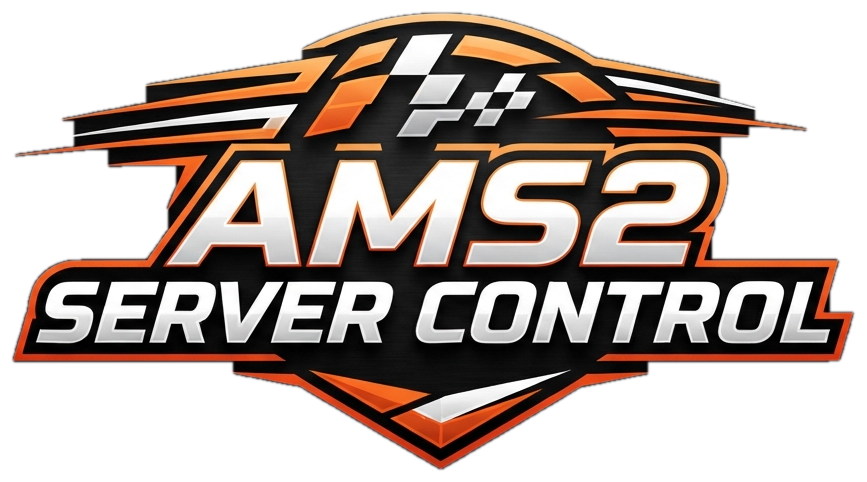

<a href="README_DE.md">Deutsch</a> · <b>English</b>

<a href="https://github.com/MaDDoX75/AMS2-Server-Control/releases/latest"><b>⬇ Download (latest version)</b></a> · <a href="CHANGELOG.md">Changelog</a>

A Windows GUI for the **Automobilista 2 Dedicated Server**: install and update the server, set up races, run championships with points, manage drivers and race control – without editing config files. Plus rankings and achievements, the **Idiot Rule** against crash kids, **automatic Discord messages** and a **network check with router guide** so your friends can really join.

*The ultimate all-in-one solution for your Automobilista 2 dedicated server*

**All-in-one solution – no config fiddling**

- **No flags to calculate, no config files to edit** – everything is done in the interface.
- **Download the tool, start it – done:** your AMS2 server is set up exactly the way you want.
- **Runs anywhere:** on your gaming PC, an old PC or a notebook. Create and manage your AMS2 Dedicated Server however and wherever you like.

> Preview version – feedback and bug reports are welcome.

## Installation

1. Put `AMS2-Server-Control.exe` anywhere – easiest is an empty folder or the dedicated server folder (next to `DedicatedServerCmd.exe`).
2. Start the EXE.
3. On the first start the **setup assistant** opens (see below). If an already configured server is found, the tool starts directly.

**No installation needed:** one EXE – no web server, no database, no Java and no Python.

## Language

The tool is available in **German** and **English**. On the first start the Windows language is preselected. You can switch at the top right of the setup assistant, and later under *Settings → Server → General → Sprache / Language* (the tool restarts afterwards). In-game chat messages (welcome, `!rank`, `!info`, race control …) follow the chosen language. The choice is stored in `AMS2-Server-Control.lang.txt` next to the tool.

## Setup assistant

Opens automatically on the first start and any time via *Settings → Experts → Setup assistant*.

1. **Server** – the tool searches all Steam libraries, the tool folder and its subfolders. You always choose:
   - use a **found installation**,
   - **install fresh via SteamCMD** (free, no Steam login, app 1338040) – suggested target is `<tool folder>\Server`, or
   - **choose a folder yourself**.

   When switching to another installation you can **copy your data**: settings, presets, championships, results, penalties and VIP list.
2. **Installation** – SteamCMD is downloaded if needed (it lives in a `steamcmd` folder *next to* the server folder) and installs the server with a progress bar and log. If Steam reports “Missing configuration” on the very first run, the tool retries automatically up to 3 times.
3. **Network** – a checklist: local IPv4 of this PC (tip: always assign it the same address in your router), the ports to forward (**8766, 27015, 27016**, TCP and UDP, IPv4 only – button *Copy ports*), a DS-Lite/CGNAT check via your router (UPnP) and the server log, bind IP and Windows Firewall.
4. **Done** – summary. When the server folder changes, the tool restarts.

## Getting-started assistant

Appears on the very first start of AMS2 Server Control and any time via *Settings → Server → General → Getting-started assistant*. Something sensible is preselected on every page, so you can simply keep clicking “Next”.

1. Welcome · 2. Server name, password, max. players · 3. Track (cards with search, ★ = beginner tips) · 4. Cars (free choice, popular classes or any class) · 5. Length (*Short* / *Medium* / *Long*) · 6. Realism (*Relaxed* / *Balanced* / *Simulation*) · 7. Points on/off · 8. Summary → **Save & start server** or **Save only**.

## Main window

- **Navigation** – Overview, Quick race, Championships, Drivers, Chat, Results, Penalties, Community, Website, Presets; at the bottom Monitor, Help and Settings.
- **Overview** – live status, players, track, next championship race, network traffic light.
- **Quick race** – **time-lapse races** (20–120 min or any length, felt duration 6/12/24 h); **🎲** random track, **🎲 Random weather** and random date; summary card at the top, track and car selection as cards, sessions, weather & time, rules & driving aids, race options and scoring. **Start race** saves and (re)starts the server, **Apply live** takes effect from the next session without a restart. A **pit lane** speed limit (track default or 40–200 km/h) is under Rules & driving aids. The page adapts to the window width. **★ Choose race series** and **Load preset** at the top; presets are created and managed on their own page. **★ Choose race series** sets the classes (multiclass for IMSA, WEC and Le Mans Series) and the option **only tracks matching the class** hides kart, oval, RX and truck tracks for circuit cars and shows the historic layouts for historic cars.
- **Presets** – own page (✎) in the navigation below Community: preset cards with **New**, **Edit**, **Duplicate**, **Delete** and **Race it in quick race**. Editing opens the quick race editor in *preset mode* with an orange banner and **Save preset** / **Cancel** – your quick race is set aside meanwhile and comes back unchanged.
- **AI opponents** – tick »Fill grid with AI« next to the grid settings. **AI slots = grid size − max. players**: with 32 slots and 32 max. players there is no AI; the tool shows the free AI slots and asks when saving.
- **Championships** – several races with their own points system and standings. Real calendars as templates (GT3 series 2022–2026, IMSA 2026 and 2019, WEC 2026, Le Mans Series 2005, FIA GT 2005, Porsche Supercup, Super Trofeo, DTM 1991/1992). Step 1: **Load starting values from** (quick race or preset), the **★ race series** button shows the chosen series, and its own **Vehicles** box (free choice, one class, multiclass with max. cars per class, fixed car); the setup applies immediately. **★ Race series** in step 1 sets the classes, filters the tracks and shows only that series' calendars; championships can be **exported/imported** (`.ams2champ`) with progress and results or as a fresh championship – existing ones are never overwritten; tracks missing in AMS2 are replaced by similar ones. The big **Start next race** button runs the next round. **Step 2** uses a race series as track source: choose »— no race series (all tracks) —« or a series – the list then shows only its races (original date, length, replacement note, ✓ if already in the calendar); add single races or **Add all** (replace or append), mix series, **🎲 Random season**, **🎲 Roll weather**, **🎲** random date. **Continuous mode** (step 4): if nobody is online for a set time the race is skipped without scoring; at the end the calendar starts over (points carry on or new season, old one archived). **Without restart** (Championships → Automation): after the race the next championship race is sent live to the server – everyone stays in the lobby; if nobody is online the server simply restarts, and if the success ballast changes the server restarts 30 seconds after an announcement.
- **Drivers** – tab **On the server** (live player list: private message, kick, ban, penalty record) and **VIP & admins** (reserved slots, VIP list, admin commands). Bans are on the **Penalties** page.
- **Community** – **Welcome & chat** (greeting, chat commands, chat language) and **Discord** (automatic messages).
- **Website** – **General** (on/off, sample data, title, Discord link, design, joke ads), **Sections & rules** and **View** (open, update, folder).
- **Chat** – admin chat with history.
- **Results** – every session is archived. Statistics with rankings, lap records and driver profiles, CSV export.
- **Monitor** – CPU, RAM, network and ping of the PC and the server, server log.
- **Automation** (Championships page; admin commands and VIP list on the Drivers page → »VIP & admins«, welcome & chat on the new **Community** page) – championship without restart, next-track announcement, **Idiot Rule** (off by default: crashes count as points by impact strength – hard hit 1, contact ½, light touch 0; AI ½, same opponent again ½, start phase ½ except hard hits, pushing off +½, pile-up at most 1 except for the cause; points expire after 5 min; warnings at 2 and 4, kick at 6 with »BUSTED IDIOT«, ban for repeat offenders; driver status normal → flagged → BUSTED IDIOT with a note on joining and a second chance after clean races; test mode with AI; penalty record and permanent achievements per Steam ID; race ban for repeat offenders – 3 races, then +3 or doubled, max. 12; new **Penalties** page with overview, ban list, race control penalties and Idiot Rule settings), **admin commands** in the game chat for listed Steam IDs (`!skip`, `!skiprace`, `!restart`, `!kick name`, `!ai on/off`, `!admin`) and the weighting for random weather. Needs the tool running.
- **Settings** – export/import of all settings (`.ams2settings`), server name (optionally with track/championship appended), update check on start, password, network with **network check**, BoP & class limit, scoring & points, performance & power, expert options, server installation & update.

## Help & updates

- **? Help** in the navigation opens the help window with the tabs **Guide**, **Features** (this README) and **Changelog** (all changes). The texts are built into the EXE.
- **Check for updates** looks for a newer version on GitHub (`MaDDoX75/AMS2-Server-Control`). If you want, the tool downloads the new `AMS2-Server-Control.exe`, closes, replaces the file and restarts. The server keeps running.
- Before each update the tool backs up the previous EXE in `ServerControl\backups\exe`; **»Back to v…«** in the Help window restores it. On the first start of a new version the tool offers a **desktop shortcut** once (also available as a button in Help).
- The tool checks automatically on start (can be switched off under *Settings → Server → Display*).

## Race control (penalties)

Right-click a driver in a result → *Give penalty*: **point deduction** (position stays), **time penalty** (result is re-sorted, points recalculated) or **disqualification**. A reason is required, the penalty can be announced in chat. Penalized drivers are shown in red with ⚑ and a tooltip. All penalties can be listed and removed again; the original result is never changed.

## Save buttons: red and green

All save buttons show whether something is unsaved: **red with »●«** = unsaved changes, **green** = everything saved. This applies to Settings (Save, Save + restart), Quick race (Save only), preset mode (Save preset) and the championship editor (Save championship). »Apply live« is not affected.

## Server addon “TGC_Server_Manager”

The tool installs its own Lua addon when saving (called `tgc_manager` up to v0.197 – on the next server start with v0.198 the old addon is removed automatically and the ranking, results and records are kept). It provides the welcome message, chat commands (`!help`, `!rank`, `!top`, `!best`, `!record`, `!info`, `!next`; `!mystats`, `!achievements` and `!discord` are answered by the tool), points and the server ranking (also when the tool is closed), VIP slots and class limits. It also sends a **personal greeting** with the driver's points in the server ranking and the running championship, supports a `{link}` placeholder (e.g. your Discord – falls back to the website's Discord link), announces **VIPs** in the in-game chat (optional) and tells every driver his **success ballast** before the race. Changes take effect after a server restart.

## Discord (Community → Discord)

- Three **webhook links**, one per channel: **server status**, **results**, **championships** (Discord: edit channel → Integrations → Webhooks → New Webhook → Copy Webhook URL). **Send test** checks each link.
- Links are stored **encrypted** (readable only on this PC with your Windows account) and are not exported. Never share them.
- **Server online/offline**: one message that is kept up to date (track, vehicles, session, players, championship). **Result** after every race with players (podium, class winners, fastest lap, standings, optional BUSTED IDIOT kicks). **New championship** at the first race or with the **Discord** button.
- Every message shows the **server name to copy** – paste it into the AMS2 server browser search (partial names work). Messages in German or English; the tool must be running.

## Local website (menu item Website)

- The tool builds its own **website** in `ServerControl\website\Server1` – open `index.html` with **Open website** or a double click, no web server needed.
- Contents: running **championship** (calendar, standings, last podium), **news** (wins, streaks, lap records, achievements, match point, new drivers), **latest results**, **season ranking**, **drivers** with a **driver card** (stats, classes, tracks, cars, penalty record, achievements), **server statistics** (most driven cars, most popular tracks, classes, most active drivers, lap records) and the server status.
- Tabs: **overview** (rotating news, next race, last podium, top 5, fun facts), **championship** (all championships as cards, points progression, hall of champions), **results**, **drivers**, **statistics** (with honours) and **server rules** (copyable server name, join guide, automatic and your own rules). Each section can be switched off in the tool.
- **Achievements** with custom round badges (bronze to platinum); new ones pop up, wiggle and glow with »NEW!«; **3 designs** (TGC, dark, light + auto); optional **joke ads** with rotating pictures (9 ads); **virtual repair costs** (every impact converted to euros by strength and car class – driver card, ranking, »Wrecking ball« honour); **sample data** to try it out. Steam IDs are never shown. Uploading comes with v0.3.

## So friends can join

- **Network check** (Settings → Network, traffic light on the overview): Windows Firewall (with an **Allow in firewall** button), public IPv4 (DS-Lite), control interface (port 9000) exposure and – 2 and 5 minutes after the server starts – whether the server is listed in the **Steam server browser**. **Open ports via UPnP** if the router allows it.
- **Router guide**: FRITZ!Box step by step with pictures, plus short guides and manufacturer links for Speedport, Vodafone Station, o2 HomeBox, TP-Link, ASUS, Netgear and other routers. IP and ports filled in, with copy buttons.

- The **bind IP** must be empty (with `127.0.0.1` only your own PC can join).
- Forward the ports **8766, 27015, 27016** (UDP and TCP) to this PC in your router, IPv4 only. Always assign the PC the same IPv4 address.
- With **DS-Lite** (no public IPv4 of your own) friends cannot connect from outside – the setup assistant checks this.
- Allow `DedicatedServerCmd.exe` in the Windows Firewall (asked on the first start).

## Files

Everything is stored in the `ServerControl` subfolder of the server folder: `settings.json`, `presets\`, `backups\`, `logs\`, `results\`, `chat\`, `championships\`, `penalties.json`. Next to the tool: `AMS2-Server-Control.path.txt` (chosen server folder) and `AMS2-Server-Control.lang.txt` (language).

## Experimental: rented servers

The tool is built for a server on your own PC. On a rented server (e.g. Zap) currently:

- **The addon works there too** if the host gives access to the `lua` folder and `server.cfg` (FTP or file manager). Welcome message, chat commands, VIP slots, class limits and result recording on the server then work.
- **Not possible yet**: driver list, admin chat, apply live, fetching results into the tool, uploading points for the greeting, and start/stop/restart. For these the tool needs the server on the same PC.
- Support via FTP is planned. Ask your host first whether Lua addons are allowed.

## About

**AMS2 Server Control**
Developed by MaDDoX for THC Sim Racing.
Version 0.236 · November 2026
Website: https://github.com/MaDDoX75/AMS2-Server-Control

AMS2 Server Control © 2026 MaDDoX · The Game Central. All rights reserved.
The Game Central [TGC] and the TGC logos are the property of MaDDoX.
The THC Sim Racing logo [THC] is the property of THC Sim Racing.

## Legal

**Use:** The program may be used privately free of charge and passed on unchanged. Selling it or publishing modified versions requires the author's permission.

**No warranty:** Use at your own risk. The program writes `server.cfg` and other files of the dedicated server (a backup is made first each time). No liability is accepted for data loss, server outages or errors in standings and results.

**Not an official product:** This program is a fan project and is not affiliated with Reiza Studios. "Automobilista 2" is a trademark of Reiza Studios. Names of racing series, cars, manufacturers and tracks (e.g. IMSA, DTM, GT World Challenge, Porsche, Nürburgring) are trademarks of their respective owners and are used for descriptive purposes only – there is no affiliation with them. The program controls the official AMS2 Dedicated Server through its configuration files, HTTP API and Lua interface and does not change anything in the game. SteamCMD and Steam are services of Valve.
