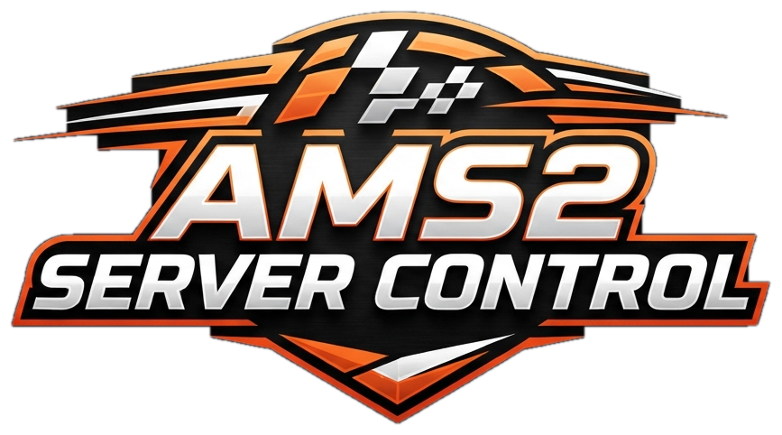

<b>Deutsch</b> · <a href="README.md">English</a>

<a href="https://github.com/MaDDoX75/AMS2-Server-Control/releases/latest"><b>⬇ Download (neueste Version)</b></a> · <a href="CHANGELOG_DE.md">Changelog</a>

GUI für den **Automobilista 2 Dedicated Server**: Server installieren und einrichten, Schnellrennen und Meisterschaften fahren, Start, Stopp und Neustart per Knopfdruck. Dazu kommen Admin-Chat, Fahrerliste mit Kick und Bann, Ergebnisse und Statistik mit Rangliste und Achievements, Chat-Befehle wie `!rank`, die **Idioten-Regel** gegen Crash-Kids, **automatische Discord-Nachrichten** und ein **Netzwerk-Check mit Router-Anleitung**, damit Freunde wirklich beitreten können.

**All-in-One-Lösung – ohne Config-Gefummel**

- **Keine Flags berechnen, keine Config-Dateien im Editor bearbeiten** – alles läuft über die Oberfläche.
- **Tool herunterladen, starten – fertig:** Dein AMS2-Server wird so eingerichtet, wie du es willst.
- **Läuft überall:** auf deinem Gaming-PC, auf einem alten PC oder Notebook. Erstelle und verwalte deinen AMS2 Dedicated Server, wie und wo du willst.

## Installation

1. `AMS2-Server-Control.exe` irgendwo hinlegen, am einfachsten in den Ordner des Dedicated Servers (neben `DedicatedServerCmd.exe`).
2. Die EXE starten.
3. Beim ersten Start öffnet sich der **Einrichtungs-Assistent** (siehe unten). Ist schon ein eingerichteter Server da, startet das Tool direkt.

**Keine Installation nötig:** eine EXE – kein Webserver, keine Datenbank, kein Java und kein Python.

## Sprache / Language

Das Tool gibt es auf **Deutsch** und **Englisch**. Beim ersten Start ist die Windows-Sprache vorausgewählt. Im Einrichtungs-Assistenten kannst du oben rechts umschalten, später unter *Einstellungen → Server → Allgemein → Sprache / Language* (danach startet das Tool neu). Die Chat-Nachrichten im Spiel (Willkommen, `!rank`, `!info`, Rennleitung …) folgen der gewählten Sprache. Die Auswahl steht in `AMS2-Server-Control.lang.txt` neben dem Tool.

## Einrichtungs-Assistent

Öffnet sich beim ersten Start automatisch und jederzeit über *Einstellungen → Experten → Einrichtungs-Assistent*.

1. **Server**: Das Tool sucht in allen Steam-Bibliotheken und neben dem Tool nach dem Dedicated Server und zeigt alle Funde als Karten. Du wählst immer selbst:
   - eine **gefundene Installation benutzen**,
   - **neu per SteamCMD installieren** (kostenlos, ohne Steam-Login, App 1338040). Vorgeschlagen wird der Unterordner `Server` im Ordner des Tools, oder
   - einen **Ordner selbst wählen**.
   
   Wechselst du auf eine andere Installation, kannst du **deine Daten übernehmen**: Einstellungen, Vorlagen, Meisterschaften, Ergebnisse, Strafen und VIP-Liste. Die alte Installation bleibt unverändert.
2. **Installation**: SteamCMD wird bei Bedarf geladen und installiert den Server, mit Fortschrittsbalken und Log. Beim allerersten Start aktualisiert sich SteamCMD selbst. Meldet Steam dabei „Missing configuration“ oder gibt es Verbindungsprobleme, versucht das Tool es automatisch bis zu 3-mal. Danach werden die Daten kopiert.
3. **Netzwerk**: eine Checkliste mit
   - der lokalen IPv4 des PCs und dem Tipp, ihm im Router immer dieselbe Adresse zuzuweisen,
   - den freizugebenden Ports (Knopf **Ports kopieren**),
   - der Prüfung auf **DS-Lite/CGNAT**: Das Tool fragt die Fritzbox per UPnP nach ihrer öffentlichen IPv4 und vergleicht sie mit der Adresse, die der Server im Log meldet,
   - Bind-IP und Windows-Firewall.
4. **Fertig**: Zusammenfassung. Bei einem Wechsel des Server-Ordners startet das Tool neu.

Der gewählte Ordner wird in `AMS2-Server-Control.path.txt` neben dem Tool gespeichert. SteamCMD liegt im Ordner `steamcmd` **neben** dem Server-Ordner. In den Server-Ordner selbst darf es nicht, das lehnt Steam ab. Beispiel bei einer Neuinstallation: Tool in `D:\AMS2\`, Server in `D:\AMS2\Server\`, SteamCMD in `D:\AMS2\steamcmd\`. SteamCMD bleibt für spätere Updates liegen.

## Start-Assistent (erste Schritte)

Erscheint beim allerersten Start von AMS2 Server Control und jederzeit über *Einstellungen → Server → Allgemein → Start-Assistent*. Er ist für alle gedacht, die noch nie einen Server betrieben haben. Auf jeder Seite ist ein sinnvoller Wert vorausgewählt, man kann also einfach immer „Weiter“ klicken.

1. **Start**: kurze Erklärung, was das Tool kann (Schnellrennen, Meisterschaft, Einstellungen)
2. **Server**: Servername, optionales Passwort, maximale Spielerzahl, jeweils mit Erklärung
3. **Strecke**: Auswahl als Karten mit Suchfeld. Strecken mit ★ sind Einsteiger-Tipps.
4. **Autos**: freie Wahl, beliebte Klassen (z. B. GT3) oder jede andere Klasse
5. **Dauer**: *Kurz* (10/10/15 min), *Mittel* (15/15/30 min) oder *Lang* (20/20/60 min) für Training, Quali und Rennen
6. **Regeln**: *Locker* (Fahrhilfen erlaubt, kein Verschleiß), *Ausgewogen* (wie im echten Auto) oder *Simulation* (keine Fahrhilfen, voller Schaden, Defekte)
7. **Punkte**: mit oder ohne Wertung
8. **Fertig**: Zusammenfassung, dann **Speichern & Server starten** oder **Nur speichern**

Alles landet in den ganz normalen Einstellungen. Danach siehst und änderst du es im Schnellrennen und unter Einstellungen.

## Server aktualisieren

*Einstellungen → Experten → Server aktualisieren* holt die neueste Server-Version per SteamCMD. Läuft der Server, fragt das Tool vorher und stoppt ihn. Fortschritt und Ergebnis stehen direkt darunter. Während des Updates lässt sich der Server nicht starten. Nach einem AMS2-Update danach **Listen laden** klicken, damit neue Autos und Strecken auftauchen.

## Erste Schritte

1. Links unten **Einstellungen** öffnen und **Speichern** klicken. Das Tool schreibt eine saubere `server.cfg`. Die alte Datei wird vorher in `ServerControl\backups` gesichert.
2. Links **Schnellrennen** öffnen, Strecke, Autos und Regeln einstellen und **Rennen starten** klicken.

Alle Strecken, Autos, Klassen, Wetter- und Regelwerte sind mit Namen im Tool eingebaut. Sie stammen direkt aus der `DedicatedServerCmd.exe` (Server-Build vom 01.09.2026).

## Aufbau des Fensters

- **Kopfleiste oben**: groß der **Servername** (auch in der Titelleiste und Taskleiste), dazu Status des Servers, aktuelle Strecke und Session, Spieler, dazu kleine Balken für CPU, RAM, Upload und Ping. Grün = alles gut, gelb ab 70 %, rot ab 90 %.
- **Links**: der große Knopf **Server starten / Server stoppen**, darunter **Neustart**. Sind Spieler online, fragt das Tool vorher nach.
- **Navigation links**: Übersicht, Schnellrennen, Meisterschaften, Fahrer, Chat, Ergebnisse, Strafen, Community, Vorlagen. Unten **Monitor**, **Hilfe** und **Einstellungen**.

| Seite | Inhalt |
|---|---|
| **Übersicht** | Karten für Server, Strecke, Session und Spieler, Knopf **Nächste Session**, Warnungen, **Netzwerk-Ampel** und die **Live-Reihenfolge** (KI per Schalter einblendbar) |
| **Schnellrennen** | Das komplette Renn-Setup auf einer Seite (siehe unten) mit dem Knopf **Rennen starten** |
| **Meisterschaften** | Meisterschaften anlegen und fahren, mit eigener Tabelle (siehe unten); Reiter **Automatik** (ohne Neustart weiter, Ansagen, Zufallswetter) |
| **Fahrer** | Reiter **Auf dem Server** (wer gerade da ist, mit Rechtsklick-Menü) und **VIP & Admins** (reservierte Plätze, VIP-Liste, Admin-Befehle) |
| **Strafen** | Übersicht auffälliger Fahrer, Sperrliste, Strafen der Rennleitung, Einstellungen der Idioten-Regel |
| **Chat** | Admin-Chat (siehe unten) |
| **Community** | **Willkommen & Chat** (Begrüßung, Chat-Befehle, Chat-Sprache) und **Discord** (automatische Nachrichten) |
| **Vorlagen** | gespeicherte Renn-Setups (siehe unten) |
| **Ergebnisse** | Reiter **Ergebnisse** (alle Sessions, Gesamt oder pro Klasse, CSV-Export) und **Statistik** (Top-Fahrer, Rundenrekorde, Fahrerprofil per Doppelklick) |
| **Monitor** | Reiter **Auslastung** (Rundinstrumente, Verlauf, Höchstwerte) und **Server-Log** |
| **Einstellungen** | alles, was den Server selbst betrifft (siehe unten) |

## Schnellrennen

- **Oben**: **★ Rennserie wählen** und daneben **Vorlage** wählen + **Vorlage laden**. Angelegt und verwaltet werden Vorlagen auf der eigenen Seite **Vorlagen** (siehe unten).
- Darunter die **Rennkarte**: Sie zeigt auf einen Blick Strecke, Fahrzeuge, Training/Quali/Rennen, Datum, Uhrzeit, Wetter und ob gewertet wird. Sie aktualisiert sich sofort, wenn du etwas änderst.
- **★ Rennserie wählen**: Rennserie aussuchen, das Tool stellt die Klassen ein (bei IMSA, WEC und Le Mans Series als **Multiclass**) und zeigt nur noch passende Strecken.
- **Zeitraffer-Rennen** (Ablauf): Renndauer per Knopf (20–120 min) oder frei, dazu »Gefühlte Dauer« 6, 12 oder 24 Stunden – z. B. 40 Minuten fahren und Tag und Nacht erleben. Das Tool stellt den Zeitraffer für Tageszeit und Wetter passend ein und zeigt Start, Ende und ob es durch die Nacht geht.
- **🎲 Zufall**: neben der Streckensuche eine zufällige passende Strecke, unter »Wetter & Uhrzeit« **🎲 Zufallswetter** für Training, Quali und Rennen, neben dem Datum ein zufälliges Datum.
- Darunter Sprungknöpfe zu den Abschnitten.
- **Nur zur Klasse passende Strecken** (Schalter bei der Strecke, standardmäßig an): keine Kart-, Oval-, RX- oder Truck-Strecken für Rundstrecken-Autos, Karts nur auf Kartbahnen, Ovale nur für Stock-USA/Formula-USA. Bei historischen Autos (z. B. Gruppe A) erscheinen die historischen Varianten statt der modernen, bei modernen Autos keine Layouts, die mehr als 20 Jahre älter sind.
- **Strecken und Autos als Karten**: Die gewählte Strecke bzw. das gewählte Auto hat einen orangen Rahmen und „✓ gewählt“. DLC-Inhalte sind violett markiert. *Autos in der Auswahl* zeigt pro Klasse alle Autos mit Hersteller, Baujahr und DLC.
- Die Abschnitte passen sich der Fensterbreite an (kein seitliches Scrollen). Unter **Regeln & Fahrhilfen** gibt es den Kasten **Boxengasse** mit dem Tempolimit (Strecken-Standard, 50/60/80/100 km/h oder eigener Wert 40–200 km/h).
- **Abschnitte** (untereinander, mit Mausrad scrollen): 1 Strecke, 2 Fahrzeuge, 3 Ablauf (Training, Quali, Rennen, Grid, KI, Datum), 4 Wetter & Uhrzeit, 5 Regeln & Fahrhilfen, 6 Renn-Optionen, 7 Wertung.
- **KI-Gegner**: Unter *Ablauf → Startfeld* (bzw. in der Meisterschaft unter *Startfeld & KI*) »Startfeld mit KI auffüllen« anhaken. Wichtig: **KI-Plätze = Startplätze − max. Spieler**. Bei 32 Startplätzen und 32 max. Spielern gibt es keine KI – das Tool zeigt die freien KI-Plätze an und fragt beim Speichern nach.
- **Wertung aktivieren**: an = das Rennen zählt für die Rangliste; aus = Spaßrennen, das Ergebnis wird gespeichert, aber ohne Punkte. Vorlagen merken sich den Schalter.
- **Unten**:
  - **Rennen starten**: speichert und startet den Server neu (oder startet ihn, wenn er aus ist). Sind Spieler online, fragt das Tool vorher und bietet als Alternative »Live übernehmen« an.
  - **Nur speichern**: schreibt die `server.cfg`, ohne neu zu starten. Der Knopf ist **rot** (»● Nur speichern«), solange es ungespeicherte Änderungen gibt, und **grün**, wenn alles gespeichert ist.
  - **Live übernehmen**: schickt das Setup an den laufenden Server. Es gilt ab der nächsten Session, ganz ohne Neustart.

## Vorlagen

Eigene Seite links in der Navigation (**✎ Vorlagen**, unter Monitor). Eine Vorlage ist ein fertiges Renn-Setup: Strecke, Fahrzeuge, Ablauf, Wetter und Regeln.

- Jede Vorlage ist eine **Karte** mit Strecke, Fahrzeugen und Dauer. Klick wählt sie aus, **Doppelklick** bearbeitet sie.
- **+ Neue Vorlage**: startet mit dem aktuellen Schnellrennen.
- **Bearbeiten**: öffnet die Vorlage im Schnellrennen-Editor. Oben erscheint ein oranger Hinweis »Du bearbeitest die Vorlage …« mit **Vorlage speichern** und **Abbrechen**. Dein eigentliches Schnellrennen ist so lange beiseitegelegt und kommt danach unverändert zurück. »Rennen starten«, »Nur speichern« und »Live übernehmen« sind in dieser Zeit gesperrt.
- **Duplizieren**, **Löschen** und **Im Schnellrennen fahren** (lädt die Vorlage ins Schnellrennen; gestartet wird wie gewohnt mit »Rennen starten«).
- Vorlagen liegen in `ServerControl\presets` und stehen auch in der Meisterschaft unter »Startwerte laden aus« zur Auswahl.

## Speicher-Knöpfe: rot und grün

Alle Speicher-Knöpfe zeigen, ob etwas noch nicht gespeichert ist: **rot mit »●«** = ungespeicherte Änderungen, **grün** = alles gespeichert. Das gilt für *Einstellungen* (Speichern, Speichern + Neustart), *Schnellrennen* (Nur speichern), den *Vorlagen-Modus* (Vorlage speichern) und den *Meisterschafts-Editor* (Meisterschaft speichern). Das Tool prüft das etwa jede Sekunde. »Live übernehmen« ist davon nicht betroffen. Abbrechen im Meisterschafts-Editor oder Vorlagen-Modus fragt nach, wenn noch etwas ungespeichert ist.

## Meisterschaften

- **Übersicht**: Jede Meisterschaft ist eine Karte mit Klassen, Fortschritt, Führendem und dem nächsten Rennen. Klick auf eine Karte öffnet sie.
- **Neue Meisterschaft** in vier Schritten:
  1. **Grundlagen**: Name, **Startwerte laden aus** und **Fahrzeuge**. Die Startwerte kommen aus dem aktuellen Schnellrennen oder einer Vorlage und gelten sofort; danach passt du alles direkt in den Feldern darunter an. Der Knopf **★ Rennserie** zeigt die gewählte Serie, z. B. »★ IMSA WeatherTech 2026«. Im Kasten **Fahrzeuge** wählst du wie im Schnellrennen Freie Wahl, Eine Klasse, Multiclass (mit max. Autos pro Klasse) oder Festes Auto. **★ Rennserie** füllt die Fahrzeuge automatisch aus, filtert in Schritt 2 die Strecken (»Passend zur Klasse«) und zeigt dort nur die Kalender dieser Serie. Regeln, Fahrhilfen, Ablauf, Startfeld und KI kommen aus dem Setup.
  2. **Strecken**: Strecken links per **Drag & Drop** in den Rennkalender ziehen (oder doppelklicken), Reihenfolge per Ziehen ändern, zurück nach links ziehen oder »Entfernen« löscht. Pro Rennen: Datum (im Spiel), Startzeit, Wetter und Renndauer in **Runden**, **Minuten** oder **wie im Setup**. »Dauer für alle Rennen übernehmen« setzt Dauer und Art für den ganzen Kalender.
     **Rennserie als Streckenquelle**: Oben steht zuerst »— keine Rennserie (alle Strecken) —«, links siehst du dann alle Strecken. Wählst du eine Rennserie, zeigt die Liste links **nur deren Rennen** mit Originaldatum, Länge und Ersatz-Hinweis; Rennen, die schon im Kalender sind, haben ein ✓. Einzeln per Doppelklick oder Ziehen holen (mit Datum, Dauer und Ersatz-Hinweis) oder **Alle übernehmen** (ersetzen oder hinten anhängen). Serien lassen sich mischen. **🎲 Zufalls-Saison** würfelt einen Kalender aus Strecken, die zur Klasse passen (ohne Wiederholung), **🎲 Wetter würfeln** das Wetter aller Rennen und **🎲** neben dem Datum ein zufälliges Datum.
     **Kalender einer echten Rennserie**: GT World Challenge Europe (auch nur Sprint oder nur Endurance), DTM, ADAC GT Masters, IMSA GTD und Intercontinental GT Challenge, jeweils 2022 bis 2026 (gleiche Kalender zusammengefasst) mit den echten Terminen. Neu: IMSA WeatherTech 2026, IMSA DPi-Ära 2019, WEC 2026, Le Mans Series 2005, FIA GT 2005, Porsche Supercup 2026, Lamborghini Super Trofeo Europe 2026 und DTM 1991/1992 (Gruppe A). Langstreckenrennen laufen dabei automatisch nach Zeit. Dazu der Kalender **Langstrecken-Klassiker** (Daytona 24h, Bathurst 12h, Sebring 12h, Imola 6h, Nürburgring 24h, Le Mans 24h, Spa 24h, Watkins Glen 6h, Interlagos 6h, Monza 6h, Kyalami 9h, Petit Le Mans 10h): Diese Rennen laufen automatisch nach Zeit, die Dauer ist pro Rennen änderbar (bis 1440 Minuten). Strecken, die AMS2 nicht hat, werden durch eine ähnliche ersetzt und im Kalender markiert (z. B. »Ersatz für Norisring«). »Durch gewählte Strecke ersetzen« tauscht die Strecke eines Rennens.
  3. **Punkte**: eigene Punkte, Extrapunkte und Prozent-Regel nur für diese Meisterschaft (vorbelegt mit den Standardwerten). Dazu **Dauerbetrieb (Community-Modus)**: Ist eine einstellbare Zeit lang niemand online, wird das Rennen ohne Wertung übersprungen und das nächste geladen; am Kalender-Ende geht es von vorn los – wahlweise laufen die Punkte weiter oder es beginnt eine neue Saison (die alte bleibt als Archiv in der Liste). Optional wird das Wetter bei jedem Rennen neu gewürfelt.
  4. **Prüfen** und speichern.
- **Nächstes Rennen starten**: stellt Strecke, Datum, Uhrzeit, Wetter und alle Regeln des nächsten Rennens ein und startet den Server neu. Den Knopf gibt es auch in der Übersicht, solange eine Meisterschaft läuft. Nach dem Rennen hakt das Tool es automatisch ab.
- **Ohne Neustart weiter** (Meisterschaften → Automatik): Nach dem Rennen lädt das Tool das nächste Meisterschaftsrennen automatisch. Sind Spieler online, schickt es das Rennen **live** an den Server – alle bleiben in der Lobby, im Chat kommen nächste Strecke, Tabellenspitze und der eigene Ballast. Ist niemand online, startet der Server einfach neu. Ändert sich der Erfolgsballast, startet der Server nach einer Ansage 30 Sekunden später neu – der Server liest den Ballast nur beim Start (getestet).
- **Server starten** startet das nächste Rennen der Meisterschaft, die gerade geöffnet ist. Sonst lädt es automatisch das nächste Rennen, wenn das zuletzt geladene schon gefahren ist.
- **Rechtsklick auf ein Rennen**: jetzt starten, **als nächstes Rennen festlegen** (»▶ als Nächstes« – »Nächstes Rennen starten« lädt dann genau dieses Rennen, danach geht es wieder der Reihe nach; »Vormerkung aufheben« stellt die Reihenfolge wieder her), wiederholen, als gefahren / nicht gefahren markieren.
- **Rennkarten** zeigen Datum, Startzeit, Wetter und den Ablauf mit Training, Quali und Rennen.
- **Ballast von Hand**: Rechtsklick auf einen Fahrer in der Tabelle → »Ballast fürs nächste Rennen ändern …«. Der Wert gilt nur für das nächste Rennen und ist mit ✎ markiert; »Ballast automatisch berechnen« nimmt die Änderung zurück.
- **Tabelle**: Punkte, Siege, Podien und die Punkte pro Rennen (R1, R2 …; * = mit Extrapunkten, NC = nicht gewertet). Die ersten drei in Gold, Silber und Bronze. KI-Fahrer zählen nicht.
- **Exportieren …** (in der Meisterschaft) speichert sie als `.ams2champ`-Datei: Setup, Rennserie, Kalender, Punkte-Regeln, Fortschritt sowie alle bisherigen Ergebnisse und Strafen.
- **Importieren …** (in der Liste) fragt, ob mit Fortschritt und Ergebnissen oder als frische Meisterschaft importiert wird. Eine vorhandene Meisterschaft wird nie überschrieben: Gibt es sie schon, schlägt das Tool einen anderen Namen vor (z. B. »… (2)«). Ergebnisse, die schon im Archiv liegen, werden nicht doppelt gespeichert.
- Jede Meisterschaft liegt als eigene Datei in `ServerControl\championships`.
- »Rennen starten« im Schnellrennen beendet den Meisterschaftsmodus wieder (der Server fährt dann das Schnellrennen-Setup).

## Fahrer, Teams & Ballast

- **Meisterschaft → Schritt 3 Fahrer**: Startliste mit Steam-ID, Team und Balance of Performance. Fahrer lassen sich aus den Ergebnissen oder vom laufenden Server übernehmen.
- **Teamwertung** und **feste Namen** sind Optionen in diesem Schritt, ebenso die **Allow-Liste** (nur bei Meisterschaftsrennen).
- **Erfolgsballast** (Schritt 1): *Nach dem letzten Rennen* – nur die Platzierung im vorherigen Rennen zählt; *Aufbauend mit Abbau* – Gewicht addiert sich und baut sich ohne Podium wieder ab, bis zum Höchstgewicht.
- **Einstellungen → BoP & Klassen-Limit → Balance of Performance**: Ballast, Leistung (90–110 %) und Luftwiderstand (90–110 %) pro Fahrer für alle Rennen. Gilt nach dem nächsten Server-Neustart.

## Hilfe & Updates

- Links in der Navigation **? Hilfe**: öffnet das Hilfe-Fenster mit den Reitern **Anleitung** (Schritt für Schritt), **Funktionen** (diese README) und **Changelog** (alle Änderungen). Die Texte stecken in der EXE und passen immer zur Version.
- **Auf Updates prüfen** (im Hilfe-Fenster) schaut auf GitHub (`MaDDoX75/AMS2-Server-Control`) nach einer neueren Version. Auf Wunsch lädt das Tool die neue `AMS2-Server-Control.exe`, beendet sich, tauscht die Datei aus und startet neu. Der Server läuft dabei weiter.
- Beim Start prüft das Tool das automatisch, abschaltbar unter *Einstellungen → Server → Anzeige → Beim Start nach Updates suchen*.

## Einstellungen

Links eine Liste mit sechs Seiten, oben die Knöpfe **Speichern**, **Speichern + Neustart**, **Server-Ordner öffnen**, **Exportieren …** und **Importieren …**. Der Export speichert alle Einstellungen in einer `.ams2settings`-Datei (das Passwort nur auf Wunsch), der Import übernimmt sie nach Rückfrage – der Server-Ordner bleibt dabei unverändert. Passen die Kästen nicht nebeneinander ins Fenster, stehen sie untereinander.

Umgezogen (jeweils mit eigenen Speicher-Knöpfen): **Willkommen & Chat** (MOTD, Chat-Befehle, Chat-Sprache, Name im Chat, Begrüßung) → Seite **Community** · **VIP-Liste, reservierte Plätze, Admin-Befehle** → Seite **Fahrer**, Reiter »VIP & Admins« · **Meisterschaft ohne Neustart, Ansagen, Zufallswetter** → **Meisterschaften**, Reiter »Automatik« · **Idioten-Regel** → Seite **Strafen**.

| Seite | Inhalt |
|---|---|
| **Server** | Name, Passwort, max. Spieler, VAC-Prüfung, Sichtbarkeit im Browser, Log-Level, Sprache; **Anzeige**: Strecke/Meisterschaft am Servernamen, Update-Prüfung beim Start |
| **Netzwerk** | Bind-IP, Ports, Internet-Leitung (Standard: unbegrenzt), **Netzwerk-Check** mit Firewall-Knopf, UPnP und Router-Anleitung |
| **BoP & Klassen-Limit** | Klassen-Limit, Balance of Performance pro Fahrer |
| **Wertung & Punkte** | Punkte für Platz 1 bis 20, Extrapunkte, Prozent-Regel, neue Saison |
| **Leistung & Energie** | Tick-Rate, Priorität, Energiesparen, Höchstleistung, Laptop-Deckel |
| **Experten** | Flags-Zahl, weitere Session-Attribute, Listen laden, Diagnose speichern, Server aktualisieren |

## Wetter & Uhrzeit

- Training, Qualifying und Rennen haben jeweils eine eigene **Startzeit** und ein eigenes **Wetter**.
- Die Startzeit geht nur in vollen Stunden (z. B. 15:00 Uhr). Halbe Stunden kennt der Server nicht.
- **Echtes Wetter**: Das Spiel nimmt das echte Wetter an der Strecke.
- **Wetter-Wechsel**: 1 bis 4 Abschnitte. Das Wetter wechselt im Lauf der Session von Feld 1 zu Feld 2 usw.
- Bei Training und Quali gibt es den Schalter **wie Rennen**. Dann gelten dort Startzeit und Wetter des Rennens.
- Das **Datum** gilt für alle Sessions.
- **Max. Spieler** kann nicht größer als das Grid sein. Das Tool begrenzt den Wert automatisch.

## Monitor

- Rundinstrumente für **CPU** und **RAM** des PCs (darunter, was der Server selbst braucht), **Upload**, **Download**, **Pakete pro Sekunde** und **Ping** der Spieler.
- Upload und Download zählen den gesamten Verkehr des PCs, also auch andere Programme.
- Upload und Download stehen standardmäßig auf **unbegrenzt**: Die Anzeigen zeigen dann Mbit/s, die Balken richten sich nach dem bisher höchsten Wert, ohne Warnfarben. Wer seine Leitung einträgt (Schalter aus), bekommt Prozent und Warnfarben.
- Die Verlaufskurve zeigt die letzten 5 Minuten. Darunter stehen die Höchstwerte seit dem Start des Tools, mit Knopf zum Zurücksetzen.

## Leistung & Energie (Einstellungen → Leistung & Energie)

- **Tick-Rate**: Pause im Rennen und ohne Rennen in Millisekunden (Standard 10 / 50). Kleiner = genauer, aber mehr CPU-Last. Gilt nach »Speichern + Neustart«.
- **Priorität Server**: Normal, Höher als normal (Standard) oder Hoch. **Priorität Tool**: Normal oder Niedriger als normal (Standard). Wird sofort angewendet. Echtzeit gibt es bewusst nicht.
- **Energiesparen verhindern**: Solange der Server läuft, geht der PC nicht in den Energiesparmodus. Der Bildschirm darf trotzdem ausgehen.
- **Höchstleistung**: Solange der Server läuft, schaltet das Tool auf den Energiesparplan »Höchstleistung« und danach zurück. Stürzt das Tool ab, stellt es den alten Plan beim nächsten Start wieder her. Gibt es den Plan auf dem PC nicht, passiert nichts.
- **Laptop-Deckel**: Das Tool zeigt, was beim Zuklappen passiert. Ist das »Energie sparen«, wäre der Server weg. Mit **Deckel zu: Nichts unternehmen** wird das für den Netzbetrieb geändert, mit **Zurücksetzen** kommt der alte Wert zurück. Das Tool ändert das nie von selbst.
- **Diagnose speichern** (Einstellungen → Experten oder Monitor): schreibt die echten Antworten der Server-API in eine Textdatei in `ServerControl`. Hilft bei der Fehlersuche.

## Admin-Chat

- Seite **Chat** in der Navigation links.
- Zeigt live, was die Spieler schreiben, dazu Beitritte, Abgänge und Session-Wechsel.
- Unten „An: Alle“ oder einen Spieler wählen, Text eingeben, Enter drücken.
- Der Verlauf wird pro Tag in `ServerControl\chat` gespeichert, solange das Tool läuft.

## Fahrerliste

Rechtsklick auf einen Fahrer:

- **Privat anschreiben**
- **Kicken**
- **Bannen für 1 Stunde / 24 Stunden**: gilt bis zum nächsten Server-Neustart
- **Dauerhaft bannen**: Die Steam-ID kommt zusätzlich auf die Sperrliste in der `server.cfg` und bleibt auch nach Neustarts gesperrt
- **Als VIP eintragen / austragen**

Vor jedem Kick oder Bann fragt das Tool optional nach einem Grund. Dann geht eine Nachricht in den Chat, z. B. „[Admin] XY wird in 5 Sekunden gekickt. Grund: …“. 5 Sekunden später folgt der Kick.

Die Sperrliste steht auf der Seite **Strafen** → Sperrliste. Mit „Entbannen“ wird ein Spieler wieder aus der `server.cfg` entfernt. Das gilt ab dem nächsten Neustart.

## Server-Addon „TGC_Server_Manager“

Einige Funktionen laufen direkt im Server. Das Tool legt dafür beim Speichern das Addon `lua\TGC_Server_Manager` an und schaltet es ein. Bis v0.197 hieß es `tgc_manager`: Beim nächsten Serverstart mit v0.198 wird das alte Addon automatisch entfernt, Rangliste, Ergebnisse und Rekorde werden übernommen. **Änderungen an diesen Einstellungen gelten erst nach einem Neustart des Servers.**

- **Willkommensnachricht (MOTD)**: mehrere Zeilen mit Platzhaltern `{name}`, `{server}`, `{track}`. Optional danach Strecke, Klasse und Renndauer. Ersetzt das Standard-Addon `sms_motd`.
- **Chat-Befehle**: Die Antwort sieht nur der Fragende, den Befehl selbst sehen alle.

  | Befehl | Antwort |
  |---|---|
  | `!rank` | eigener Platz in der Rangliste, Punkte, Siege, Podien, Rennen |
  | `!top` | Top 5 des Servers |
  | `!best` | eigene Bestzeit auf dieser Strecke in der eigenen Klasse |
  | `!record` | Streckenrekord für Strecke und Klasse |
  | `!info` | Strecke, Klassen, Renndauer, Fahrhilfen |
  | `!next` | nächstes Event (z. B. nächstes Meisterschaftsrennen) |
  | `!help` | Liste der Befehle |

- **Ergebnisse**: Nach jeder Session (Training, Quali, Rennen) speichert das Addon das Ergebnis. Das Tool archiviert es dauerhaft in `ServerControl\results`, auch wenn es beim Rennen nicht offen war (das Addon hält die letzten 200 Sessions vor).
- **Rangliste**: Das Addon zählt Punkte, Siege und Podien selbst mit, damit `!rank` auch ohne Tool funktioniert. Sie beginnt bei null, sobald v0.12 läuft.
- **Reservierte Plätze**: Normale Spieler können nur „Max. Spieler – reserviert“ Plätze belegen. Wer darüber liegt, bekommt eine Nachricht und wird nach 5 Sekunden getrennt. Spieler auf der VIP-Liste kommen immer rein, solange noch ein Platz frei ist. Ist der Server komplett voll, kann auch ein VIP nicht beitreten.
- **Persönliche Begrüßung**: Wer joint, bekommt eine private Nachricht mit seinem Punktestand in der Server-Rangliste und – wenn eine Meisterschaft läuft – mit Platz und Punkten dort. Der Text ist mit Platzhaltern anpassbar (Community → Willkommen & Chat).
- **Link**: Der Platzhalter `{link}` setzt z. B. deine Discord- oder Webseiten-Adresse in die Willkommensnachricht.
- **VIP-Ankündigung**: Joint ein VIP, sehen alle im Spiel-Chat eine kurze Ankündigung (abschaltbar).
- **Ballast-Info**: Bei Erfolgsballast bekommt jeder Fahrer vor dem Rennen eine private Nachricht mit seinem Ballast.
- **Klassen-Limit**: Bei Multiclass hat jede Klasse ein Feld „max.“ (0 = unbegrenzt). Wer zu viel ist, bekommt in der Lobby alle 20 Sekunden eine Warnung. Optional wird er nach einer einstellbaren Zeit gekickt.

## Automatik, Admin & Strafen (Meisterschaften → Automatik, Fahrer → VIP & Admins, Seite »Strafen«)

- **Meisterschaft ohne Neustart** – siehe Meisterschaften.
- **Ansage im Chat**: Nach dem Rennen wird die nächste Strecke angesagt (bei Meisterschaften mit Tabellenspitze und Ballast).
- **Idioten-Regel** (standardmäßig aus): zählt Crashs im Rennen als Punkte, abhängig von der **Aufprall-Stärke**, die der Server meldet: harter Einschlag = 1, Kontakt = ½, leichter Rempler = 0. Mit KI zählt es halb, derselbe Gegner nochmal halb, in den ersten 20 Sekunden nach dem Start halb (außer bei harten Einschlägen – Vollgas in Kurve 1 zählt voll). **Abdrängen**: Knallt das andere Auto kurz nach deinem Kontakt in die Bande, gibt es +½. Massenkarambolage (4 oder mehr Autos in 5 Sekunden) = höchstens 1 Punkt – außer für den Auslöser, der 3 oder mehr Autos trifft. Punkte verfallen nach einstellbarer Zeit (Standard 5 Minuten). 1. Verwarnung ab 2, letzte Verwarnung ab 4, Kick ab 6 Punkten (einstellbar) mit der Meldung **»BUSTED IDIOT«**. Treffer mit demselben Fahrer innerhalb von 3 Sekunden zählen einmal, VIPs und Admins sind ausgenommen.
- **Fahrer-Status**: normal → auffällig (1× gekickt, Verwarnungen kommen früher) → BUSTED IDIOT (mehrmals gekickt). Beim Beitritt bekommen markierte Fahrer nach 15 Sekunden einen privaten Hinweis, auf Wunsch auch eine öffentliche Warnung. Nach einstellbar vielen sauberen Rennen (Standard 5) gibt es eine **zweite Chance** – eine Stufe zurück.
- **Rennsperre**: Wiederholungstäter werden für eine Anzahl Rennen gesperrt (Standard: 3, dann +3 bzw. verdoppeln, höchstens 12; optional dauerhaft ab der X. Sperre). Das Tool zählt nach jedem Rennen runter und kickt gesperrte Fahrer beim Beitritt mit einer Nachricht. Alternativ: nur kicken, 1 h, 24 h oder dauerhaft.
- **Seite »Strafen«** (linkes Menü): Übersicht aller auffälligen Fahrer, Sperrliste (Renn-, Zeit- und dauerhafte Sperren), Strafen der Rennleitung und die Einstellungen der Idioten-Regel. Rechtsklick in der Übersicht: Strafregister, Sperre aufheben oder verlängern, Status hoch-/zurückstufen, zurücksetzen.
- **Testmodus**: KI zählt voll, Admins zählen mit, es gibt keinen echten Kick oder Bann (»TEST: Du würdest jetzt gekickt«). Jeder Crash erscheint mit Punkten im Chat-Fenster – so lässt sich die Regel allein mit KI ausprobieren.
- **Strafregister & Achievements** werden pro Steam-ID gespeichert (Verwarnungen, Kicks, Banns, letzter Vorfall, Statistik). Achievements bleiben für immer, auch wenn Meisterschaften oder Statistik zurückgesetzt werden. Rechtsklick in der Fahrerliste: **Strafregister & Status anzeigen**, **Status hoch-/zurückstufen**, **Strafregister zurücksetzen**.
- **Admin-Befehle im Spiel-Chat** (nur für eingetragene Steam-IDs – am einfachsten per Rechtsklick in der Fahrer- oder VIP-Liste »Als Admin eintragen«): `!skip` (nächste Session), `!skiprace` (Rennen überspringen, nächstes Meisterschaftsrennen ohne Neustart – in der Lobby sofort, sonst: Rennen starten lassen → Box → Lobby), `!restart`, `!kick Name`, `!ai an` / `!ai aus` (KI auffüllen ab dem nächsten Event), `!admin` (Hilfe).
- **Zufallswetter**: Gewichtung Klar / Bewölkt / Regen für alle 🎲-Knöpfe.
- Idioten-Regel, Admin-Befehle und Dauerbetrieb brauchen das laufende Tool.

## Wertung & Punkte

- **Punkte pro Platz**: Für Platz 1 bis 20 steht neben jedem Platz ein Kästchen mit den Punkten. Standard: 25, 22, 20, 18, 16, 15, 14, 13, 12, 11, 10, 9, 8, 7, 6, 5, 4, 3, 2, 1. Ab Platz 21 gibt es keine Punkte. Hat ein Platz mehr Punkte als der davor, erscheint ein roter Hinweis.
- **Extrapunkte**: für die **Pole-Position im Qualifying** und die **schnellste Runde im Rennen**, jeweils mit Schalter zum Einschalten (Standard: je 1 Punkt). Die Pole zählt nur, wenn danach auf derselben Strecke ein Rennen gefahren wird.
- **Platzierung geht vor**: Extrapunkte überholen nie den Vordermann. Würde jemand dadurch vorbeiziehen, bekommt er nur so viele Extrapunkte, dass er knapp dahinter bleibt. Der Sieger hat also immer die meisten Punkte.
- **Wer bekommt Punkte**: nur wer mindestens **75 %** der Runden des Siegers seiner Klasse gefahren ist (einstellbar). Bei Multiclass wird jede Klasse für sich gewertet.
- **KI-Fahrer** belegen Plätze, ihre Punkte verfallen. In den Tabellen ist die KI standardmäßig ausgeblendet.
- **Training/Quali**: Gewertet wird, wer mindestens eine gültige Runde gefahren ist. Die Reihenfolge ergibt sich aus der Bestzeit.
- **Neue Saison starten**: setzt die Rangliste (Punkte, Siege, Podien, `!rank`) auf null. Die alten Ergebnisse bleiben im Archiv. Im Server gilt das nach dem nächsten Neustart. Die Statistik zeigt standardmäßig die aktuelle Saison.
- Ergebnisse behalten die Punkte, die zum Zeitpunkt des Rennens galten. Spätere Änderungen an der Punkte-Tabelle ändern alte Rennen nicht.
- Wer nicht gewertet ist, steht grau mit „NC“ und dem gefahrenen Anteil in der Tabelle.
- Fahrer werden über die Steam-ID erkannt. Namensänderungen schaden der Statistik also nicht.

## Rennleitung (Strafen)

- **Strafe vergeben**: Unter *Ergebnisse* ein Rennen öffnen, mit Rechtsklick auf einen Fahrer → *Strafe vergeben …*. Auch über den Knopf **Strafen** oben rechts.
- **Punktabzug**: Der Platz bleibt, die Punkte werden abgezogen (Standard 5).
- **Zeitstrafe**: Die Sekunden kommen auf die Gesamtzeit. Das Ergebnis wird neu sortiert und die Punkte werden neu verteilt.
- **Disqualifikation**: keine Punkte, alle dahinter rücken einen Platz auf.
- Bei Training und Quali gibt es nur die Disqualifikation.
- Eine **Begründung** ist Pflicht. Vorlagen wie „Unfaires Verhalten“ stehen in der Liste darunter. Läuft der Server, kann die Strafe auf Wunsch im Chat bekanntgegeben werden.
- Bestrafte Fahrer stehen **rot mit ⚑** im Ergebnis. Fährst du mit der Maus darüber, siehst du Strafe und Grund. Die Meisterschaftstabelle zeigt z. B. „18 (−5)“.
- **Strafenliste**: unter *Ergebnisse* über *Strafen* (alle) und in der Meisterschaft über *Strafen* (nur diese Meisterschaft). Dort kannst du eine Strafe auch wieder **aufheben**.
- Das Originalergebnis wird nie verändert, Strafen liegen getrennt in `penalties.json`.
- Die Strafen wirken sofort auf Meisterschaftstabelle, Statistik und Saison. Für `!rank` und `!top` im Server gelten sie nach dem nächsten Speichern bzw. Neustart.
- Bei einer Zeitstrafe oder Disqualifikation wird das Rennen mit der aktuellen Punkte-Tabelle neu gewertet.
- Strafen gibt es nur für echte Fahrer, nicht für die KI.

## Discord (Community → Discord)

- Drei **Webhook-Links**, einer pro Kanal: **Server-Status**, **Ergebnisse**, **Meisterschaften**. Den Link gibt es in Discord unter Kanal bearbeiten → Integrationen → Webhooks → »Neuer Webhook« → »Webhook-URL kopieren«. Mit **Test senden** prüfst du jeden Link sofort.
- Die Links sind wie Passwörter: Das Tool speichert sie **verschlüsselt** (nur auf diesem PC mit deinem Windows-Konto lesbar). Nie weitergeben und nie auf GitHub stellen. Sie werden nicht mit exportiert.
- **Server online/offline**: eine einzige Nachricht, die laufend aktualisiert wird – Strecke, Fahrzeuge, Session, Spieler, laufende Meisterschaft. Startet der Server neu (länger als 10 Minuten aus), kommt eine neue Nachricht und die alte wird gelöscht.
- **Ergebnis** nach jedem Rennen mit Spielern: Podium, Klassensieger, schnellste Runde, bei Meisterschaften die Tabellenspitze; optional die **BUSTED-IDIOT**-Kicks des Rennens.
- **Neue Meisterschaft**: automatisch beim ersten Rennen oder per Knopf **Discord** in der Meisterschaft – Fahrzeuge, Kalender, Punkte.
- Jede Nachricht zeigt den **Servernamen zum Kopieren** (ohne angehängte Strecke). In AMS2: Online → Serverbrowser → Suche → einfügen; die Suche findet auch Teile des Namens.
- Sprache der Nachrichten: Deutsch oder English. Jede Nachrichtenart lässt sich einzeln abschalten. Das Tool muss laufen.

## Damit Freunde beitreten können

- **Netzwerk-Check** (Einstellungen → Netzwerk, Ampel auch auf der Übersicht): prüft die **Windows-Firewall** (Knopf **Firewall freigeben** legt eine Regel an und entfernt alte Sperren, fragt nach Admin-Rechten), die **öffentliche IPv4** (DS-Lite/CGNAT), ob die **Steuer-Schnittstelle** (Port 9000) nach außen offen ist und – etwa 2 und 5 Minuten nach dem Serverstart – ob der Server im **Steam-Serverbrowser** steht (ohne API-Schlüssel). **Ports per UPnP freigeben** trägt die Freigaben automatisch im Router ein, wenn der Router das erlaubt.
- **Router-Anleitung**: FRITZ!Box Schritt für Schritt mit Bildern, dazu Telekom Speedport, Vodafone Station, o2 HomeBox, TP-Link, ASUS, Netgear und »Anderer Router« mit Kurzanleitung und Link zur Hersteller-Anleitung. IP und Ports sind schon eingesetzt (mit Kopier-Knopf). Auch im Einrichtungs-Assistenten.

- Die **Bind-IP** muss leer sein. Mit `127.0.0.1` kann nur dein eigener PC beitreten.
- Im Router diese Ports an deinen PC weiterleiten, jeweils UDP und TCP: **8766, 27015, 27016**. In der Fritzbox dabei das Häkchen **„IPv4 aktiviert“** setzen. IPv6 wird nicht gebraucht, der Server läuft nur über IPv4.
- Gib dem PC im Router immer dieselbe IPv4-Adresse, sonst zeigt die Freigabe nach einem Neustart ins Leere.
- Bei **DS-Lite** (keine eigene öffentliche IPv4) kommen Freunde von außen nicht durch. Der Einrichtungs-Assistent prüft das.
- Die Windows-Firewall muss `DedicatedServerCmd.exe` erlauben. Sie fragt beim ersten Start nach.

## Dateien des Tools

Alles liegt im Unterordner `ServerControl` des Server-Ordners:

- `settings.json`: deine Einstellungen im Tool
- `presets\`: gespeicherte Presets
- `backups\`: Backups von `server.cfg` (die letzten 30)
- `logs\`: Server-Logs (die letzten 30 Starts)
- `listen_cache.json`: die vom Server geladenen Listen (nur nach „Listen laden“)
- `results\`: Archiv aller Ergebnisse (wird nie automatisch gelöscht)
- `chat\`: Chatverlauf pro Tag
- `diagnose_….txt`: Dateien von »Diagnose speichern«
- `championships\`: die Meisterschaften
- `penalties.json`: die vergebenen Strafen

## Hinweise

- Die HTTP-API des Servers bleibt nur lokal erreichbar (`127.0.0.1`). Das Tool braucht sie für Status, Spielerliste und die Listen.
- Stopp beendet den Serverprozess direkt.
- Umlaute in MOTD oder Admin-Chat können im Spiel-Chat je nach Spielversion falsch angezeigt werden.
- Die Log-Ausgabe kann leicht verzögert in Blöcken kommen.
- Wurde der Server außerhalb des Tools gestartet, erkennt das Tool ihn und kann ihn stoppen, zeigt aber kein Log.

## Experimentell: gemietete Server

Das Tool ist für einen Server auf dem eigenen PC gebaut. Bei einem gemieteten Server (z. B. Zap) gilt bisher:

- **Das Addon läuft auch dort**, wenn der Anbieter Zugriff auf den Ordner `lua` und auf `server.cfg` gibt (FTP oder Dateimanager). Dann funktionieren Willkommensnachricht, Chat-Befehle, VIP-Plätze, Klassen-Limit und die Aufzeichnung der Ergebnisse auf dem Server.
- **Noch nicht möglich**: Fahrerliste, Admin-Chat, Live übernehmen, Ergebnisse ins Tool holen, Punktestand für die Begrüßung hochladen sowie Start, Stopp und Neustart. Dafür braucht das Tool den Server auf demselben PC.
- Geplant ist eine Unterstützung per FTP. Frag vorher beim Anbieter nach, ob Lua-Addons erlaubt sind.

## Über das Programm

**AMS2 Server Control**
Entwickelt von MaDDoX für THC Sim Racing.
Version 0.2 · November 2026
Webseite: https://github.com/MaDDoX75/AMS2-Server-Control

AMS2 Server Control © 2026 MaDDoX · The Game Central. Alle Rechte vorbehalten.
The Game Central [TGC] sowie die TGC-Logos sind Eigentum von MaDDoX.
Das THC-Sim-Racing-Logo [THC] ist Eigentum von THC Sim Racing.

## Rechtliches

**Nutzung:** Das Programm darf kostenlos privat genutzt und unverändert weitergegeben werden. Verkauf oder Veröffentlichung veränderter Versionen nur mit Zustimmung des Autors.

**Keine Gewähr:** Die Nutzung erfolgt auf eigene Gefahr. Das Programm schreibt die `server.cfg` und weitere Dateien des Dedicated Servers (vorher wird jeweils ein Backup angelegt). Für Datenverlust, Serverausfälle oder Fehler in Wertungen und Ergebnissen wird keine Haftung übernommen.

**Kein offizielles Produkt:** Dieses Programm ist ein Fan-Projekt und steht in keiner Verbindung zu Reiza Studios. „Automobilista 2“ ist eine Marke von Reiza Studios. Das Programm steuert den offiziellen AMS2 Dedicated Server über dessen Konfigurationsdateien, HTTP-API und Lua-Schnittstelle und verändert nichts am Spiel. SteamCMD und Steam sind Dienste von Valve.
